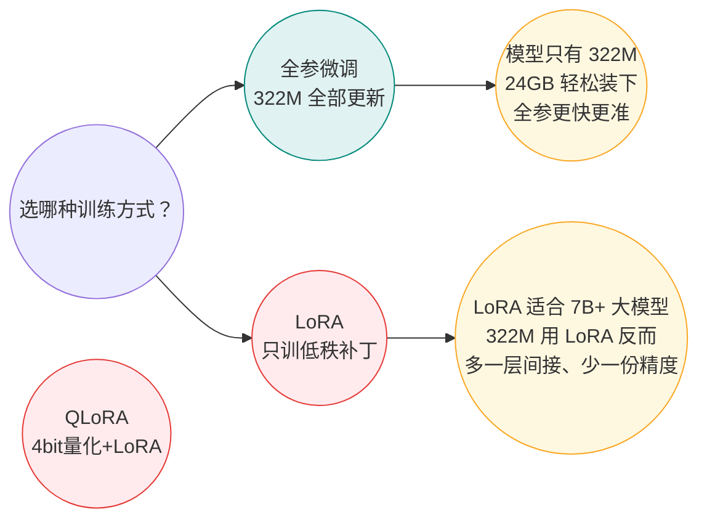

# Laya 微调训练配置（T5.4 前置——参数、依据、内存预算）

> 消费方：你在云端跑训练时对照本档；M5 基线报告引用；M8 qwen-jey 训练参照。

## 一、训练方式：全参微调（不是 LoRA）

**为什么不用 LoRA**：LoRA 的价值在于“模型太大装不下”——7B 以上才需要。Laya 整个模型 322M，全参训练状态（权重 1.3G＋梯度 1.3G＋AdamW 2.6G ≈ 5.2G）在 4090 的 24GB 里余量充足；LoRA 反而引入低秩近似损失＋adapter 管理复杂度。

**如果 M8 的 qwen-jey（0.8B）训练**：0.8B×(4+4+8)bytes ≈ 12.8G，4090 24GB 仍可全参，LoRA 依然不必要。

## 二、全部超参（一张表）

| 参数 | 值 | 来源与依据 |
|------|----|-----------| 
| **训练方式** | 全参（编码器＋决策头） | 322M 小模型全参最优（上表） |
| **EPOCHS** | 4 | 官方 typed-decisions 同配置（2k 条→0.766 正是 4 epoch） |
| **MICRO_BATCH** | 12 序列/forward | 4090 24GB 内存预算（官方 T4×2 用 8×2GPU=16 序列/GPU；24GB 单卡可放 12） |
| **GRAD_ACCUM** | 2 | 有效批次 = 12×2 = 24 序列/update（官方 8×2×4=64 序列/update；我们数据少、适当缩小） |
| **GROUP_SIZE** | 4 | GRPO 基线组大小（同批同题采 4 个噪声样本互比，抵消题难度差异） |
| **SIGMA_START→END** | 0.4 → 0.1 | 高斯探索噪声：前重后轻（初期多试错、后期收敛） |
| **LR_ENCODER** | 2.5e-5 | 编码器（预训练过）用小学习率 |
| **LR_HEAD** | 1.0e-4 | 决策头（从头训）用大学习率——4 倍差异是官方调优结果 |
| **weight_decay** | 0.01 | AdamW 标准正则 |
| **scheduler** | CosineAnnealingLR → eta_min=1e-6 | 余弦退火（后期自动降 lr） |
| **grad clip** | max_norm=1.0 | 防梯度爆炸 |
| **loss** | loss_rl + 1.0 × loss_ce | RL 探索（REINFORCE+GRPO）＋ 1.0 权重的软交叉熵引导（防纯 RL 不稳） |
| **max_len** | 3200 | M4 配比 v1.3 真实上沿（1K/2K/3.2K 档覆盖；8K 档 30 条也用 3200 截断——验证过无信息损失） |
| **head_max_len** | 256 | 出厂值不变（题目＋选项区预算） |
| **梯度检查点** | encoder＋head 均启用 | 省 4090 内存（代价：前向重算一次≈慢 30%） |
| **precision** | fp16 autocast + GradScaler | 4090 原生 fp16（比 T4 的 fp16+bf16 混用更简单） |
| **温度** | LBFGS 后拟合（calib 切片 60 条） | 训后校准（非训练参数——RLCD 目标管方向，温度管系统偏移） |
| **calib 切片** | 数据的 1/10，固定种子隔离 | 官方逻辑：训练过的样本上模型已过拟合、温度拟合无意义 |

## 三、内存预算（4090 24GB）

| 组件 | 占用 |
|------|------|
| 模型权重（fp32） | 1.3 GB |
| 梯度 | 1.3 GB |
| AdamW 状态（动量+方差） | 2.6 GB |
| 激活值（batch=12, seq=3.2K, 梯度检查点开） | ~6 GB |
| **合计** | **~11.2 GB**（余量 12.8 GB ✓） |

## 四、M5 的 T5.2 试跑门已验证什么

| 验证项 | 结果 | 含义 |
|--------|------|------|
| loss 下降 | 1.48→0.88（−41%） | 梯度流通、优化器工作正常 |
| 拟合能力 | 0.348→0.804（+131%） | 模型能从数据学到信号（能拟合才谈泛化） |
| 输出结构等价 | ✅ | 训后概率和=1、键合法——没把模型训坏 |
| 温度拟合 | choice 0.86 / score 1.60 / noul 1.06 | LBFGS 校准机制完整跑通 |

## 五、与官方 notebook 的差异清单

| 项 | 官方 | 我们 | 理由 |
|----|------|------|------|
| GPU | T4 ×2 (16GB×2) DDP | RTX 4090 ×1 (24GB) | 算力自由单卡 |
| batch | 8/GPU × 2 GPU × 4 accum = 64 | 12 × 2 = 24 | 数据 300 条 vs 官方 2k 条——有效批次按比例缩小 |
| max_len | 1024 写死 | 3200 | 我们数据 1K~3.2K（官方只做短题） |
| 数据 | typed-decisions 2k 条 | laya_trainset 300 条 | M4 合成（配比 v1.3） |
| 其余全部 | **一致** | — | 官方验证过的核心不碰（T5.1 选型原则） |
